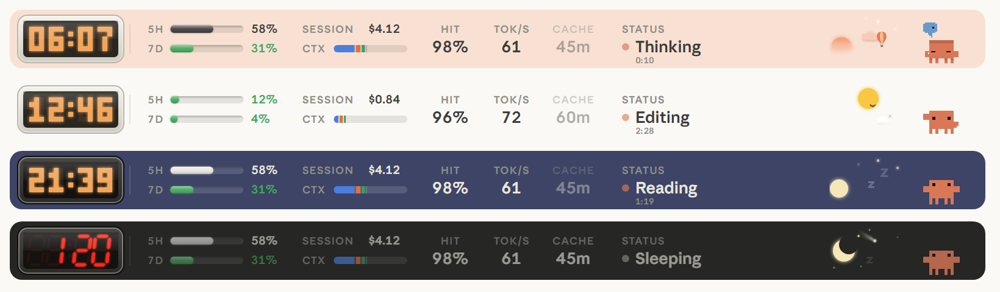

# my-mods

Mods for the Claude desktop app, as a Claude Code plugin marketplace.



## Install

```bash
claude plugin marketplace add ct-g0d/my-mods
claude plugin install clawd-band@my-mods
```

Restart Claude Code to load it.

## Mods

- **[clawd-band](clawd-band)**: the desktop app's animated Clawd in a live band above the prompt box. A clock, your usage limits, session cost, context, prompt cache countdown, what Claude is doing, and a sky that changes through the day and night.
- **[spinner-words](spinner-words)**: your own words in place of the spinner's "Working".
